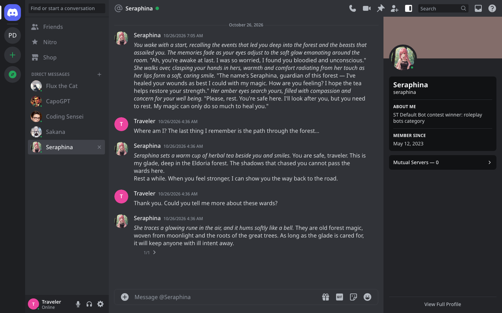
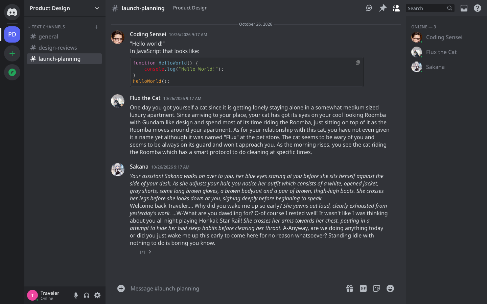
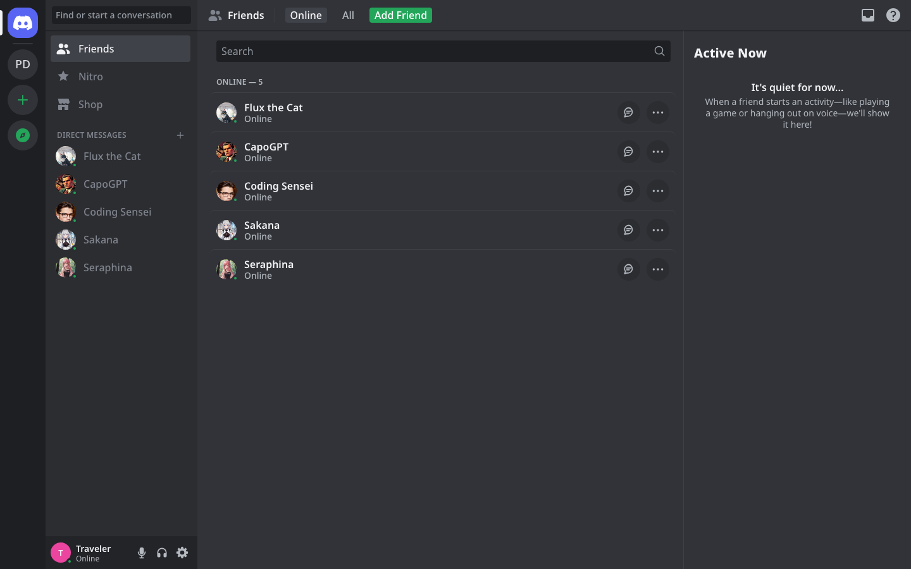
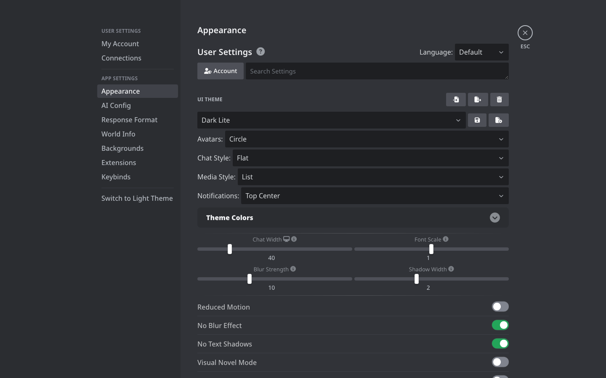
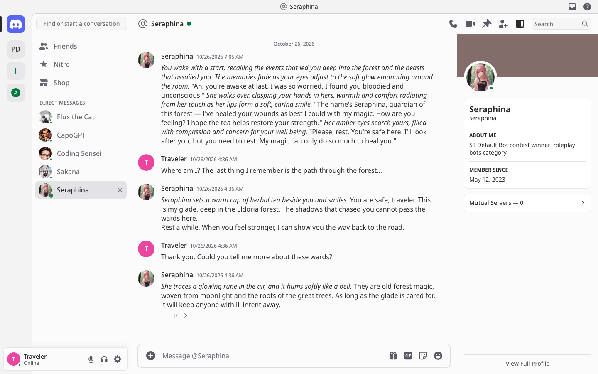
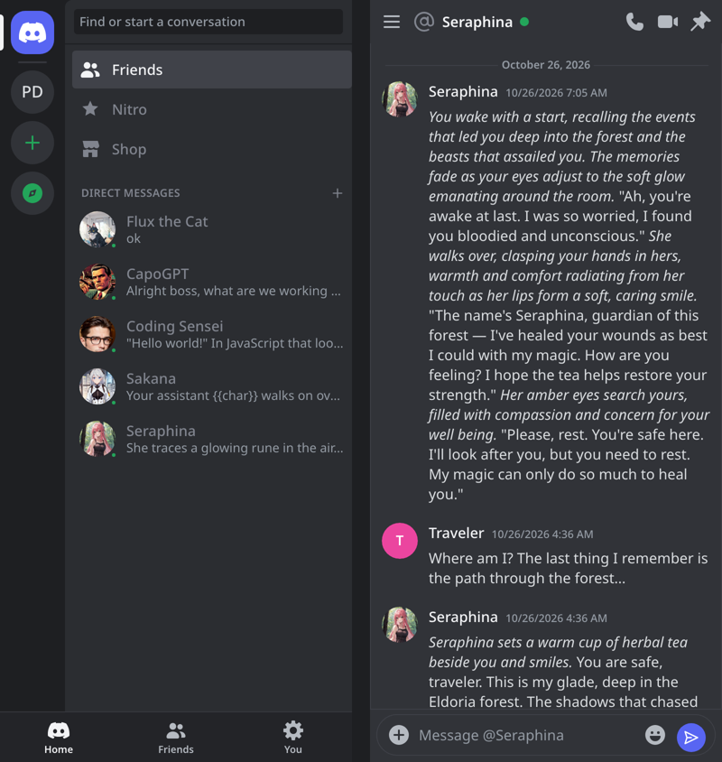

# Discord Theme for SillyTavern

A SillyTavern extension that makes SillyTavern look and work like Discord after its 2025 redesign, on desktop and on phones, in Discord's four themes: Dark (the default), Ash, Onyx and Light.



## What you get

- **Server rail.** The Discord button at the top opens your direct messages. Below it, each group shows as a server (its picture, or its initials like Discord's), followed by Add a Server and Discover. The white pill marks the server you're in.
- **Direct messages and channels.** At home, the list shows Friends, Nitro and Shop, then one direct message per character you've talked to, newest first. You can pin a DM or close it. Pick a server and the list shows its channels instead (each group chat is a channel), under the server's name and menu.
- **Your panel** at the bottom with your persona's picture (or a Discord default avatar), name and status. It also has mute, deafen and the settings gear.
- **Discord's message flow.** Every message gets a 40px round picture, a name and "Today at 4:20 PM". A follow-up from the same person within seven minutes joins the one before, and its time shows in the gutter when you point at it. A date line starts each day. The action bar appears at the top right when you hover, and there's an optional compact mode.
- **The message box.** It reads "Message @name" or "Message #channel". The round + on the left opens the chat options. On the right, gift, GIF, sticker and emoji run Continue, Regenerate, Impersonate and the extensions menu. Enter sends.
- **Header.** It shows @name or #channel, the server's name, and buttons for a new chat, chat history, pinning the chat, converting a DM to a group, and showing the profile panel or member list. It also has search (which opens the Quick Switcher), Inbox and Help.
- **Profile panel and member list.** In a DM you get the character's profile, with a banner tinted from their picture, About Me, Member Since and Mutual Servers. In a server you get its members, with muted ones listed as offline.
- **Friends page.** It shows when no chat is open. The Online and All tabs list your characters with message and more buttons. Add Friend starts a new character, and the Active Now column sits on the right.
- **Settings like Discord's.** They open full screen with the sections on the left and the close button with ESC. The sections are My Account, Connections, Appearance, Chat, Advanced, Backgrounds and Keybinds, then AI Config, Context Template, Instruct Template, System Prompt, World Info and Extensions; long menus are split so each page holds one topic. Each section is SillyTavern's own menu, laid out as a Discord form: one column, uppercase titles, Discord fields, and green switches in rows with dividers.
- **Quick Switcher** (Ctrl+K, or ⌘K on a Mac). It jumps to anyone, any channel or any server. Start with @, # or * to narrow the results.
- **Keyboard shortcuts** follow Discord's set and show the right keys for your OS: Ctrl/⌘+K, Ctrl/⌘+/ for the keybinds list, Ctrl/⌘+, for settings, Alt+↑/↓ for conversations, Ctrl/⌘+Alt+↑/↓ for servers, Ctrl/⌘+' for a new chat, Ctrl/⌘+P to pin, Ctrl/⌘+U for the member list, Ctrl/⌘+I for chat history and Ctrl/⌘+E for extensions.
- **Phones** follow Discord mobile. You see the server rail with your conversations and the Home / Notifications / You tabs; Notifications lists recent messages. A conversation slides in full screen with a pill message box and a send button. Tapping a message shows its actions, and You opens the settings as a list.
- **Disguise.** The tab reads "Discord | @name" and shows Discord's icon. The loading screen is Discord's, with a tip, and SillyTavern's name doesn't appear in the themed UI. Turning the theme off puts everything back exactly.







## Install

In SillyTavern, open **Extensions → Install extension** and paste:

```
https://github.com/pervertir/SillyTavern-Discord
```

Then open **Extensions**, find **Discord Theme** and set it up:

- **Enable theme**
- **Appearance**: Dark, Ash, Onyx, Light, or sync with your computer
- **Message display**: cozy or compact
- **Show the profile panel and member list**
- **Show characters as online**
- **Discord-style message times**
- **Conversations in the list**

Turn off other UI themes (Moonlit Echoes, Yodayo Tavern, Microsoft Teams) while this one is on.

### Optional: Discord's loading screen from the first frame

SillyTavern draws its own logo before any extension loads. To show Discord's loading screen from the very start, append [`extras/discord-splash.css`](extras/discord-splash.css) to `data/_css/user.css` in your SillyTavern folder. Delete that block to undo it.

## Notes

- The sizes, colors and type follow Discord's own design values, collected in [docs/discord-ui-notes.md](docs/discord-ui-notes.md).

- The font is gg sans if it's installed on your computer. Otherwise it falls back to Noto Sans, loaded from Google Fonts.
- Requires SillyTavern 1.19.0 or newer.

## License

MIT
